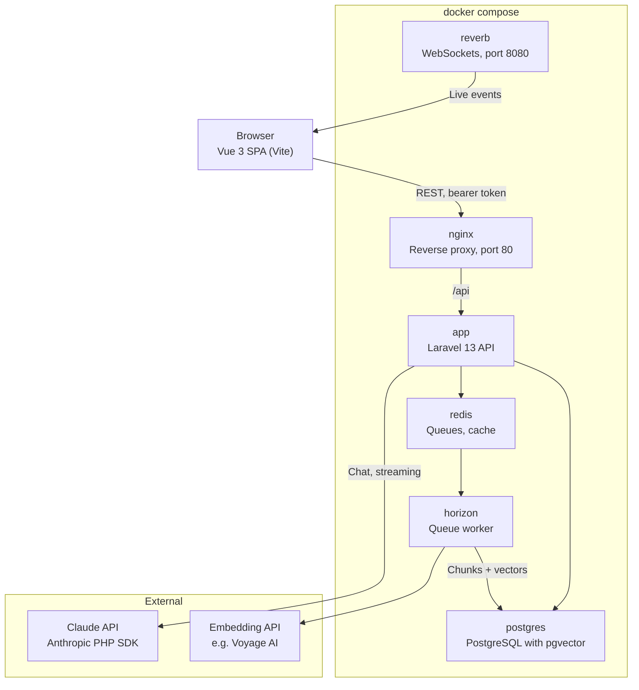

# TeamBrain – Tech Stack

As of: October 9, 2026

## Overview

TeamBrain is a Vue 3 SPA that talks to a Laravel 13 backend via a versioned REST API (`/api/v1`). All Claude and embedding calls run exclusively on the server; the frontend never sees an API key.

The split into SPA + API is deliberate: it matches existing experience, keeps streaming via `fetch` simple, and later allows further clients (CLI, Slack bot, MCP server) with the same token auth.

Backend, frontend and all services live in one monorepo and start together with `docker compose up`.

## Backend

The backend is a pure JSON API on Laravel 13 with PHP 8.3 or higher (Laravel 13 requires PHP 8.3).

| Component | Use in TeamBrain |
| --- | --- |
| Laravel 13 (PHP 8.3+) | API only, no Blade views |
| Sanctum (bearer token) | Login returns a token; abilities such as `chat`, `documents:upload`, `admin`; expiry via `expiration` |
| API Resources | Consistent JSON responses for documents, chats, messages, sources |
| Form Requests | Validation and authorization per endpoint (e.g. file type and size on upload) |
| Policies | Who may see which collection and which document; also applies to vector search |
| Queues + Horizon | Ingestion jobs (extract text, chunk, embed), agent runs, eval runs; Horizon for monitoring |
| Reverb + Echo | Live status of document processing and eval progress; private channels with bearer auth at `/broadcasting/auth` |
| Redis | Queue backend and cache |

## AI & RAG

Claude calls go through the official Anthropic PHP SDK; embeddings and vector search use PostgreSQL with pgvector. The Laravel AI SDK (new in Laravel 13) is an option for embeddings; check how well it covers the required features before adopting it.

| Component | Use in TeamBrain |
| --- | --- |
| `anthropic-ai/sdk` | Messages API, streaming, citations, prompt caching, Files API, tool use, MCP helpers (with `mcp/sdk`) |
| Models | Haiku 5.5 with effort `low` for simple questions and chat; Sonnet 5.5 with effort `high` for multi-step search (UC-09); Opus optional for comparisons and the demo |
| Eval judge | GLM 5.3 (high effort) via z.ai's Anthropic-compatible API; deliberately a different model than the agent, so it never grades its own answers |
| Embeddings | External provider (e.g. Voyage AI), since Claude does not produce embeddings itself |
| PostgreSQL + pgvector | Stores chunks with a vector column; similarity search filtered by `collection_id` |
| `pgvector/pgvector-php` | Vector type and queries in Eloquent |
| Text extraction | PDF parser for PHP; a small helper service if needed |

Future search improvements: hybrid search (vector + PostgreSQL full-text), reranking, contextual retrieval.

## Frontend

The frontend is a Vue 3 SPA using the Composition API, built with Vite.

| Component | Use in TeamBrain |
| --- | --- |
| Vue 3 + Vite | Components with `<script setup>`, fast dev server |
| Vue Router | Pages: login, chat, documents, admin insights, evals; route guards check the token |
| Pinia | Stores for auth, conversations, documents |
| Axios | Regular API calls; interceptor sets `Authorization: Bearer` and handles 401 |
| `fetch` + `ReadableStream` | Only for the chat stream, since Axios in the browser does not support token-by-token streaming |
| Laravel Echo | Receives Reverb events (upload status, eval progress) |
| Tailwind CSS | Styling |

## Infrastructure

All AI calls go through the backend, never through the browser.



The browser only talks to nginx and Reverb; Claude and embedding calls originate from the `app` container (chat) and the `horizon` worker (ingestion, evals). An additional `frontend` service runs the Vite dev server during development.

```
teambrain/
├── backend/            Laravel 13 API
├── frontend/           Vue 3 + Vite SPA
├── docker/             Dockerfiles, nginx.conf
├── docker-compose.yml  app, nginx, postgres, redis, horizon, reverb, frontend
└── README.md
```

Getting started for reviewers: `cp backend/.env.example backend/.env`, add the API keys, then `docker compose up -d` and `docker compose exec app php artisan migrate --seed`.

## API Design & Docs

The API is versioned under `/api/v1`; Scramble automatically generates OpenAPI documentation from Form Requests and API Resources, without extra annotations.

| Method | Endpoint | Purpose |
| --- | --- | --- |
| POST | `/api/v1/auth/login` | Issue a token |
| POST | `/api/v1/auth/logout` | Revoke the current token |
| GET | `/api/v1/collections` | Collections visible to the user |
| POST | `/api/v1/collections/{id}/documents` | Upload a document |
| GET | `/api/v1/documents/{id}` | Status and metadata |
| POST | `/api/v1/conversations` | Create a new chat |
| POST | `/api/v1/conversations/{id}/messages` | Ask a question; the answer is streamed |
| POST | `/api/v1/messages/{id}/feedback` | Thumbs up or down |
| GET | `/api/v1/admin/insights` | Knowledge gaps, frequent questions, costs |
| POST | `/api/v1/evals/runs` | Start an eval run |

Errors are returned consistently as JSON with an HTTP status; validation errors use Laravel's default format (422).

## Security & Quality

Security lives in the backend: tokens, policies and permission filters in the search prevent the assistant from revealing content from other collections.

- **Token storage:** A token in `localStorage` can be read via XSS. Mitigations: short expiry, logout revokes the token, no `v-html` output of model answers without sanitizing. Name the risk in the README.
- **API keys:** Anthropic and embedding keys only in the backend's `.env`, never in the repo; `.env.example` with placeholders.
- **Rate limiting:** Laravel `RateLimiter` on chat and upload endpoints to keep costs bounded.
- **Prompt injection:** Document content is treated as data, not instructions; the system prompt says so explicitly.
- **Tests:** Pest for feature and unit tests; Claude and embedding calls are mocked. Vitest for Vue components and stores.
- **Code style:** Laravel Pint (PHP), ESLint + Prettier (frontend), Larastan for static analysis.
- **CI:** GitHub Actions runs tests, Pint and ESLint on every push.
